# Architecture — Plateforme de monitoring IoT (Projet 2, groupe 10)

> Architecture cible mise à jour suite à la revue de projet pour SDATAWAY. Le cloud imposé est AWS.
> La chaîne `ESP32 → UART → Edge → HTTPS/MQTT → AWS` est une contrainte du client.

**Cahier des charges et dimensionnement :**
- **Parc :** 50 machines à café simulées (produisant une trame CSV toutes les 2 s), fonctionnant **24h/24 pendant 3 mois**.
- **Déploiement Edge :** Exécuté en local dans un **conteneur Docker** (sur PC), simulant fidèlement un boîtier Edge physique (Raspberry Pi) situé hors du Cloud.
- **Fraîcheur des données :** Latence bout-en-bout inférieure à **5 minutes** (les données ne restent jamais plus de 5 minutes dans le buffer de l'Edge avant envoi au Cloud).
- **Visualisation :** Dashboard Grafana affichant par défaut les **5 dernières minutes** (plage temporelle configurable).
- **Rétention :** Conservation des données de télémétrie sur **3 mois** (90 jours) et des journaux (logs) sur **1 an** (365 jours).

---

## 1. Schéma d'architecture

```mermaid
flowchart LR
  subgraph LOCAL["Environnement Local (PC - Docker)"]
    direction LR
    subgraph DEV["Devices : 50 machines"]
      S["Simulateurs 1 à 50<br/>device_simulator.py"]
    end

    subgraph EDGE["Edge : Conteneur Docker"]
      direction TB
      RD["Lecture série (UART)<br/>et validation CSV"]
      BUF[("Buffer local SQLite<br/>(rétention < 5 min)")]
      MQ["Client MQTT<br/>Envoi par lots (ex: 60 s)"]
      RD --> BUF --> MQ
    end

    S -->|"UART (pty socat)<br/>CSV (1 trame / 2s)"| RD
  end

  subgraph AWS["AWS Cloud"]
    direction TB
    IOT["AWS IoT Core<br/>(Broker MQTT - PaaS)"]
    LBD["Lambda Ingestor<br/>(Conteneur léger - FaaS)"]
    DDB[("Amazon DynamoDB<br/>(Rétention TTL 3 mois)")]
    
    subgraph VM_MON["VM EC2 Monitoring & Analytics (IaaS)"]
      direction TB
      ANA["Scenario Analyzer<br/>(Worker Python : patterns & silences)"]
      GRA["Grafana OSS<br/>(Fenêtre 5 min configurable)"]
    end

    SNS["Amazon SNS"]
    CW["Amazon CloudWatch Logs<br/>(Rétention 1 an)"]
  end

  USR(("Opérateur"))

  MQ -->|"MQTT/TLS 8883<br/>X.509, QoS 1 (Lots ≤ 5 min)"| IOT
  IOT -->|"Règle d'ingestion"| LBD
  LBD -->|"Écriture par lots"| DDB
  
  DDB -->|"Lecture périodique<br/>(Fenêtre glissante)"| ANA
  ANA -->|"API JSON (plugin Infinity)<br/>(5 dernières min)"| GRA
  ANA -->|"Écriture alertes / états"| DDB
  ANA -->|"Publication d'alertes"| SNS
  
  LBD -.->|"Logs d'exécution"| CW
  IOT -.->|"Logs de connexion"| CW
  ANA -.->|"Logs applicatifs"| CW
  
  GRA -->|"Dashboard Web"| USR
  SNS -->|"Email / Webhook"| USR

```

---

## 2. Composants et justification des choix

| Composant | Service | Catégorie | Rôle | Justification (et alternatives écartées) |
| --- | --- | --- | --- | --- |
| **Machines à café** | `device_simulator.py` × 50 | Device simulé (Local) | Génèrent la télémétrie CSV toutes les 2 s sur des ports série virtuels (`socat`). | Imposé par le cahier des charges. |
| **Module Edge** | **Conteneur Docker** (sur PC local) | **Edge (Local)** | Lit les 50 flux série, valide le CSV, stocke temporairement en base SQLite locale et publie des lots compressés en MQTT toutes les 60 s (strictement < 5 min). | Reproduit fidèlement un Edge hors du Cloud, sans coût d'instance EC2. **AWS IoT Greengrass** a été écarté car trop lourd à déployer et surdimensionné pour notre cas d'usage. |
| **Ingestion MQTT** | **AWS IoT Core** | **PaaS** | Broker MQTT managé, authentification mutuelle TLS (X.509), routage par règles vers Lambda. | Point d'entrée IoT natif et serverless qui absorbe les 50 machines sans serveur à maintenir. |
| **Ingestion Cloud** | **AWS Lambda** `ingestor` | **FaaS** | Conteneur léger et *stateless* : déballe le lot MQTT et l'insère dans DynamoDB. Détecte uniquement les erreurs matérielles immédiates (bits d'erreur). | Très rapide et peu coûteux car aucun calcul lourd ni lecture d'historique n'y est effectué. |
| **Stockage** | **Amazon DynamoDB** | **NoSQL (PaaS)** | Stocke la télémétrie (`Partition Key: device_id`, `Sort Key: timestamp`) avec un **TTL de 90 jours (3 mois)**, ainsi que la table des alertes. | Voir section 3 (*Pourquoi DynamoDB plutôt que Timestream ?*). |
| **Analyse des scénarios & Silences** | **Scenario Analyzer** (Python sur VM EC2) | **IaaS** | Service externe à Lambda, tournant à côté de Grafana. Lit régulièrement DynamoDB pour détecter les patterns complexes (scénarios) et les machines muettes (`silent_device`). | Une Lambda ne peut pas s'auto-déclencher en l'absence de données et est mal adaptée à l'analyse d'historique lourd. Ce worker centralise toute l'intelligence métier. |
| **Dashboard** | **Grafana OSS** (sur VM EC2) | **IaaS** | Affiche les données des **5 dernières minutes** par défaut (configurable) avec rafraîchissement automatique. Lit l'**API JSON de l'Analyzer** via le plugin open source **Infinity** (télémétrie, état des machines, alertes). | **AWS Managed Grafana** (9 $/éditeur/mois) est trop cher. Le plugin DynamoDB de Grafana est réservé à **Grafana Enterprise** (indisponible en OSS) : l'Analyzer, seul lecteur de DynamoDB, sert donc sa fenêtre glissante à Grafana, sans lecture DynamoDB supplémentaire (voir `doc/adr/0001-grafana-datasource.md`). Grafana OSS sur la VM EC2 mutualisée avec l'Analyzer reste gratuit. |
| **Alerting** | **Amazon SNS** | **PaaS** | Envoie les notifications (email/SMS) aux opérateurs lors de la détection d'un scénario critique. | Simple, découplé et quasi gratuit. |
| **Logs & Audit** | **Amazon CloudWatch Logs** | **PaaS** | Centralise les logs des Lambdas, d'IoT Core et du Scenario Analyzer avec une **rétention configurée à 1 an (365 jours)**. | Service natif AWS. Permet de respecter l'obligation de conservation des logs sur 1 an. |

---

## 3. Choix technologiques détaillés (Réponses aux points d'architecture)

### 3.1 Pourquoi DynamoDB plutôt qu'une base Time-Series (Timestream) ?

Bien que les données IoT soient temporelles, **Amazon DynamoDB** a été retenu face à **Amazon Timestream** pour trois raisons :

1. **Disponibilité AWS :** *Amazon Timestream for LiveAnalytics* (serverless) a été déprécié par AWS pour les nouveaux comptes. Son remplaçant (*Timestream for InfluxDB*) impose des instances dédiées facturées à l'heure (~50 $/mois minimum), ce qui casse le modèle de coût.
2. **Modélisation temporelle native dans DynamoDB :** En définissant `device_id` comme *Partition Key* et `timestamp` (Epoch ms) comme *Sort Key*, DynamoDB trie nativement les données par ordre chronologique. Récupérer les 5 dernières minutes d'une machine (`device_id = X AND timestamp >= now - 5m`) s'effectue via une opération `Query` extrêmement rapide et peu coûteuse.
3. **Optimisation par lots (Batching) :** En regroupant les mesures par paquets (par ex. 1 item DynamoDB = 1 minute de mesures d'une machine, soit 30 points), on divise par 30 le nombre d'écritures.

### 3.2 Pourquoi avoir retiré EventBridge Scheduler et déplacé la détection hors de Lambda ?

* **Limitation de Lambda face aux silences :** Une fonction Lambda est purement réactive (*event-driven*). Si une machine ou le conteneur Edge cesse d'émettre, aucun événement n'arrive et la Lambda d'ingestion ne s'exécute pas.
* **Lourdeur de l'analyse de scénarios :** Différencier un simple *état* (`brewing`, `updating`, `error`) d'un *scénario* évolutif (`thermal_runaway`, `memory_leak_fota`) exige d'analyser l'évolution des métriques sur plusieurs minutes ou heures. Faire ces requêtes d'historique dans la Lambda d'ingestion à chaque message ralentirait l'ingestion et multiplierait les coûts.
* **Solution :** La Lambda `ingestor` reste un conteneur ultra-léger d'écriture pure. Le **Scenario Analyzer** (déployé sur la VM EC2 aux côtés de Grafana) interroge DynamoDB toutes les 30 secondes. Il analyse les courbes pour détecter les scénarios **et** vérifie que le dernier timestamp de chacune des 50 machines est récent, remplaçant ainsi avantageusement EventBridge Scheduler et la Lambda `heartbeat-checker`.

---

## 4. Détection des scénarios (par le Scenario Analyzer)

Contrairement aux **statuts** (`off`, `booting`, `preheat`, `standby`, `brewing`, `updating`, `degraded`, `error`) qui sont transmis directement dans chaque ligne CSV, les **scénarios** sont des comportements anormaux identifiés par le **Scenario Analyzer** en lisant DynamoDB :

| Scénario | Méthode de détection (sur fenêtre glissante dans DynamoDB) | Action |
| --- | --- | --- |
| **`thermal_runaway`** | Hausse continue de la température au-dessus de la consigne (`temp > setpoint + 4°C`) sur plusieurs mesures consécutives, quel que soit le statut (y compris pendant `updating`), ou activation du bit 0 (`overheat`). | Alerte SNS (WARNING puis CRITICAL) + inscription dans la table `alerts`. |
| **`memory_leak_fota`** | Diminution progressive du *free heap* moyen lors des retours à l'état `standby` après une phase `updating` (tendance baissière calculée par régression/comparaison). | Alerte SNS (WARNING) avant le crash de la machine. |
| **`out_of_memory`** | Chute critique du *free heap* sous le seuil minimal ou activation du bit 1 (`low_memory`) suivie d'un redémarrage (`booting`). | Alerte SNS (CRITICAL). |
| **`silent_device`** | **Trou dans les données :** écart > 10 s entre deux mesures consécutives d'une machine, calculé sur les horodatages de mesure (indépendant du batching de l'Edge). Couvre les silences courts (30 à 120 s dans le simulateur). **`device_offline` :** aucune donnée reçue depuis > 5 min (panne machine ou arrêt du conteneur Edge), vérifié à chaque cycle de l'Analyzer. L'Edge ne détecte pas les silences (voir `README.md`). | `silent_device` : alerte WARNING. `device_offline` : alerte SNS (CRITICAL - Device Offline). |

---

## 5. Dimensionnement, coûts et scalabilité (50 machines, 24h/24 sur 3 mois)

### Volumétrie pour 50 machines

* **Fréquence :** 1 trame toutes les 2 secondes par machine = 30 trames/min/machine.
* **Volume total :** $50 \times 30 \times 60 \times 24 = 2\,160\,000$ mesures/jour, soit **~64,8 millions de mesures/mois** (~194,4 millions sur 3 mois).
* **Fréquence d'envoi Edge $\rightarrow$ Cloud :** Lots envoyés toutes les **60 secondes** (respecte largement la contrainte des $< 5\text{ minutes}$).
* Nombre de messages MQTT : $50 \text{ machines} \times 1 \text{ lot/min} = 2\,160\,000$ messages/mois (ou $43\,200$ messages/mois si l'Edge regroupe plusieurs machines par payload MQTT, dans la limite de facturation par tranche de 5 Ko d'IoT Core).

### Estimation des coûts mensuels AWS (US-East-1)

1. **Edge (Conteneur Docker sur PC local) :** **0,00 USD/mois** (aucune VM Cloud requise).
2. **VM Monitoring Grafana OSS + Scenario Analyzer (EC2 `t3.micro` ou `t3.small`) :** ~8,50 à 15,00 USD/mois.
3. **AWS IoT Core :** ~2,20 USD/mois (pour ~2,16M de messages MQTT).
4. **AWS Lambda (`ingestor`) :** Gratuit (inclus dans le Free Tier AWS d'1 million de requêtes/mois en groupant les lots, ou ~0,20 USD/mois sinon).
5. **Amazon DynamoDB :**
* En stockant 1 item agrégé par minute et par machine ($2,16\text{ M}$ d'écritures/mois) : **~2,70 USD/mois** en écriture.
* Stockage sur 3 mois (~15 Go avec TTL 90 jours) : **~3,75 USD/mois**.
* Lectures (Grafana + Analyzer) : **< 1,00 USD/mois**.

6. **CloudWatch Logs (rétention 1 an) :** ~2,00 USD/mois (ingestion + archivage sur 365 jours).

**Coût total estimé : ~20 à 26 USD / mois** pour les 50 machines (soit **~60 à 78 USD pour la période complète de 3 mois**, soit ~0,45 USD par machine et par mois).