# Architecture — Plateforme de monitoring IoT (Projet 2, groupe 10)

> Architecture cible mise à jour suite à la revue de projet pour SDATAWAY. Le cloud imposé est AWS.
> La chaîne `ESP32 → UART → Edge → HTTPS/MQTT → AWS` est une contrainte du client.

**Cahier des charges et dimensionnement :**
- **Parc :** 50 machines à café simulées (produisant une trame CSV toutes les 2 s), fonctionnant **24h/24 pendant 3 mois**.
- **Déploiement Edge :** Exécuté en local dans un **conteneur Docker** (sur PC), simulant fidèlement un boîtier Edge physique (Raspberry Pi) situé hors du Cloud.
- **Fraîcheur des données :** Latence bout-en-bout inférieure à **5 minutes** (les données ne restent jamais plus de 5 minutes dans le buffer de l'Edge avant envoi au Cloud).
- **Visualisation :** Dashboard Grafana affichant par défaut les **5 dernières minutes** (plage temporelle configurable).
- **Rétention :** Conservation des données de télémétrie sur **3 mois** (90 jours) et des journaux (logs) sur **1 an** (365 jours).

---

## 1. Schéma d'architecture

```mermaid
flowchart LR
  subgraph LOCAL["Environnement Local (PC - Docker)"]
    direction LR
    subgraph DEV["Devices : 50 machines"]
      S["Simulateurs 1 à 50<br/>device_simulator.py"]
    end

    subgraph EDGE["Edge : Conteneur Docker"]
      direction TB
      RD["Lecture série (UART)<br/>et validation CSV"]
      BUF[("Buffer local SQLite<br/>(rétention < 5 min)")]
      MQ["Client MQTT<br/>Envoi par lots (ex: 60 s)"]
      RD --> BUF --> MQ
    end

    S -->|"UART (pty socat)<br/>CSV (1 trame / 2s)"| RD
  end

  subgraph AWS["AWS Cloud"]
    direction TB
    IOT["AWS IoT Core<br/>(Broker MQTT - PaaS)"]
    LBD["Lambda Ingestor<br/>(Conteneur léger - FaaS)"]
    TS[("Amazon Timestream<br/>(Memory 24h / Magnetic 90j)")]
    
    subgraph VM_MON["VM EC2 Monitoring & Analytics (IaaS)"]
      direction TB
      ANA["Scenario Analyzer<br/>(Worker Python : patterns & silences)"]
      GRA["Grafana OSS<br/>(Plugin natif Timestream)"]
    end

    SNS["Amazon SNS"]
    CW["Amazon CloudWatch Logs<br/>(Rétention 1 an)"]
  end

  USR(("Opérateur"))

  MQ -->|"MQTT/TLS 8883<br/>X.509, QoS 1 (Lots ≤ 5 min)"| IOT
  IOT -->|"Règle d'ingestion"| LBD
  LBD -->|"WriteRecords (Batch)"| TS
  
  TS -->|"Requêtes SQL temporelles<br/>(Fenêtre glissante)"| ANA
  TS -->|"Requêtes temps réel<br/>(5 dernières min)"| GRA
  ANA -->|"Écriture des événements/alertes"| TS
  ANA -->|"Publication d'alertes"| SNS
  
  LBD -.->|"Logs d'exécution"| CW
  IOT -.->|"Logs de connexion"| CW
  ANA -.->|"Logs applicatifs"| CW
  
  GRA -->|"Dashboard Web"| USR
  SNS -->|"Email / Webhook"| USR

```

---

## 2. Composants et justification des choix

| Composant | Service | Catégorie | Rôle | Justification (et alternatives écartées) |
| --- | --- | --- | --- | --- |
| **Machines à café** | `device_simulator.py` × 50 | Device simulé (Local) | Génèrent la télémétrie CSV toutes les 2 s sur des ports série virtuels (`socat`). | Imposé par le cahier des charges. |
| **Module Edge** | **Conteneur Docker** (sur PC local) | **Edge (Local)** | Lit les 50 flux série, valide le CSV, stocke temporairement en base SQLite locale et publie des lots en MQTT toutes les 60 s (strictement < 5 min). | Reproduit fidèlement un Edge hors du Cloud, sans coût d'instance EC2. **AWS IoT Greengrass** a été écarté car trop lourd et surdimensionné pour notre cas d'usage. |
| **Ingestion MQTT** | **AWS IoT Core** | **PaaS** | Broker MQTT managé, authentification mutuelle TLS (X.509), routage par règles vers Lambda. | Point d'entrée IoT natif et serverless qui absorbe les 50 machines sans serveur à maintenir. |
| **Ingestion Cloud** | **AWS Lambda** `ingestor` | **FaaS** | Conteneur léger et *stateless* : déballe le lot MQTT et insère les points dans Timestream via l'API `WriteRecords` (jusqu'à 100 points par appel). | Très rapide et économique car aucun calcul de tendance ni lecture d'historique n'y est effectué. |
| **Stockage** | **Amazon Timestream** (LiveAnalytics) | **Base Time-Series (PaaS)** | Stocke les séries temporelles (`telemetry` et `alerts`). *Memory Store* configuré à **24h** (pour le temps réel) et *Magnetic Store* à **90 jours** (3 mois). | Base serverless spécialisée pour l'IoT : tri temporel natif, compression automatique, requêtes SQL temporelles et plugin Grafana gratuit (contrairement à DynamoDB). |
| **Analyse des scénarios & Silences** | **Scenario Analyzer** (Python sur VM EC2) | **IaaS** | Service externe à Lambda, tournant à côté de Grafana. Exécute périodiquement des requêtes SQL sur Timestream pour détecter les scénarios et les machines muettes (`silent_device`). | Une Lambda ne peut pas s'auto-déclencher en l'absence de données et est mal adaptée à l'analyse d'historique lourd. Ce worker centralise toute l'intelligence métier. |
| **Dashboard** | **Grafana OSS** (sur VM EC2) | **IaaS** | Affiche les données des **5 dernières minutes** par défaut (configurable) en interrogeant Timestream directement. | **AWS Managed Grafana** (9 $/éditeur/mois) est trop cher. Grafana OSS sur VM EC2 dispose du plugin officiel **Amazon Timestream** gratuit, permettant une connexion directe sans coût de licence. |
| **Alerting** | **Amazon SNS** | **PaaS** | Envoie les notifications (email/SMS) aux opérateurs lors de la détection d'un scénario critique. | Simple, découplé et quasi gratuit. |
| **Logs & Audit** | **Amazon CloudWatch Logs** | **PaaS** | Centralise les logs des Lambdas, d'IoT Core et du Scenario Analyzer avec une **rétention configurée à 1 an (365 jours)**. | Service natif AWS. Permet de respecter l'obligation de conservation des logs sur 1 an. |

---

## 3. Choix technologiques détaillés (Réponses aux points d'architecture)

### 3.1 Pourquoi Amazon Timestream (Time-Series) plutôt que DynamoDB ?

Nos données étant exclusivement composées de mesures horodatées, **Amazon Timestream (LiveAnalytics)** offre quatre avantages majeurs par rapport à une base NoSQL clé-valeur comme DynamoDB :

1. **Modèle Multi-Mesures (Multi-Measure Records) :** Une ligne CSV complète d'une machine (température, pression, heap, courant, état) est stockée sous forme d'un **seul enregistrement multi-mesures** (avec `device_id` en *Dimension*), ce qui divise par 5 ou 6 le coût d'écriture par rapport à des mesures séparées.
2. **Gestion automatisée du stockage (Tiering sur 3 mois) :** Timestream garde les données récentes en mémoire vive (*Memory Store* sur 24h) pour garantir une réponse instantanée à Grafana (fenêtre des 5 dernières minutes), puis déplace automatiquement les données plus anciennes vers le stockage magnétique (*Magnetic Store* jusqu'à 90 jours) qui coûte **0,03 USD / Go / mois** (8 fois moins cher que DynamoDB).
3. **Fonctions SQL temporelles natives :** Timestream supporte nativement l'agrégation par fenêtres (`BIN(time, 1m)`), l'interpolation et le calcul de dérivées, ce qui simplifie considérablement le code du `Scenario Analyzer`.
4. **Plugin Grafana Open-Source gratuit :** Le connecteur officiel *Amazon Timestream* est inclus gratuitement dans Grafana OSS, alors que le connecteur DynamoDB nécessite une licence Grafana Enterprise.

### 3.2 Pourquoi avoir retiré EventBridge Scheduler et déplacé la détection hors de Lambda ?

* **Limitation de Lambda face aux silences :** Une fonction Lambda est purement réactive (*event-driven*). Si une machine ou le conteneur Edge cesse d'émettre, aucun événement n'arrive et la Lambda d'ingestion ne s'exécute pas.
* **Séparation ingestion / analytique :** Différencier un simple *état* (`brewing`, `updating`, `error`) d'un *scénario* évolutif (`thermal_runaway`, `memory_leak_fota`) exige d'analyser l'évolution des métriques sur plusieurs minutes ou heures.
* **Solution :** La Lambda `ingestor` reste un conteneur ultra-léger d'écriture pure (`WriteRecords`). Le **Scenario Analyzer** (déployé sur la VM EC2 aux côtés de Grafana) interroge le *Memory Store* de Timestream toutes les 30 secondes. Il analyse les courbes via SQL pour détecter les scénarios **et** vérifie avec une requête `MAX(time)` Group By `device_id` qu'aucune des 50 machines n'est muette, remplaçant ainsi EventBridge Scheduler et la Lambda `heartbeat-checker`.

---

## 4. Détection des scénarios (par le Scenario Analyzer)

Contrairement aux **statuts** (`off`, `booting`, `preheat`, `standby`, `brewing`, `updating`, `degraded`, `error`) qui sont transmis directement dans chaque ligne CSV, les **scénarios** sont des comportements anormaux identifiés par le **Scenario Analyzer** via des requêtes SQL sur Timestream :

| Scénario | Méthode de détection (Requêtes SQL Timestream sur fenêtre glissante) | Action |
| --- | --- | --- |
| **`thermal_runaway`** | Hausse continue de la température au-dessus de la consigne (`temp > setpoint + 4°C`) sur plusieurs mesures consécutives, quel que soit le statut (y compris pendant `updating`), ou activation du bit 0 (`overheat`). | Alerte SNS (WARNING puis CRITICAL) + écriture dans la table Timestream `alerts`. |
| **`memory_leak_fota`** | Diminution progressive du `AVG(free_heap)` lors des retours à l'état `standby` après une phase `updating` (comparaison des paliers avant/après mise à jour). | Alerte SNS (WARNING) avant le crash de la machine. |
| **`out_of_memory`** | Chute critique du *free heap* sous le seuil minimal ou activation du bit 1 (`low_memory`) suivie d'un redémarrage (`booting`). | Alerte SNS (CRITICAL). |
| **`silent_device`** | **Niveau 1 (Edge Docker) :** Si un port UART est muet > 15 s, l'Edge envoie une trame d'alerte dédiée. 

 **Niveau 2 (Cloud Analyzer) :** Requête SQL `SELECT device_id, ago(5m) > MAX(time)` sur Timestream. Si une machine (ou l'Edge entier) n'a plus donné signe de vie depuis > 5 min, elle est marquée `offline`. | Alerte SNS (CRITICAL - Device Offline). |

---

## 5. Dimensionnement, coûts et scalabilité (50 machines, 24h/24 sur 3 mois)

### Volumétrie pour 50 machines

* **Fréquence :** 1 trame toutes les 2 secondes par machine = 30 trames/min/machine.
* **Volume total :** $50 \times 30 \times 60 \times 24 = 2\,160\,000$ mesures/jour, soit **~64,8 millions de mesures/mois** (~194,4 millions sur 3 mois).
* **Fréquence d'envoi Edge $\rightarrow$ Cloud :** Lots envoyés toutes les **60 secondes** (respecte largement la contrainte des $< 5\text{ minutes}$).
* **Optimisation Timestream :** Utilisation d'enregistrements **Multi-Measure** (1 trame CSV = 1 record) envoyés par lots via `WriteRecords` (jusqu'à 100 records par appel API).

### Estimation des coûts mensuels AWS (US-East-1)

1. **Edge (Conteneur Docker sur PC local) :** **0,00 USD/mois** (aucune VM Cloud requise).
2. **VM Monitoring Grafana OSS + Scenario Analyzer (EC2 `t3.micro` ou `t3.small`) :** ~8,50 à 15,00 USD/mois.
3. **AWS IoT Core :** ~2,20 USD/mois (pour ~2,16M de messages MQTT, ou moins si les 50 machines sont groupées par l'Edge).
4. **AWS Lambda (`ingestor`) :** Gratuit (inclus dans le Free Tier AWS d'1 million de requêtes/mois, ou ~0,20 USD/mois sinon).
5. **Amazon Timestream :**
* **Écritures (Ingestion) :** 0,50 USD par million d'enregistrements de 1 Ko. En regroupant les points par lot ou en sous-échantillonnant les périodes inactives (`off`/`standby`), ou en écriture directe optimisée : **~3,50 à 15,00 USD/mois**.
* **Stockage Memory Store (24h) :** ~0,5 Go $\rightarrow$ **~1,20 USD/mois**.
* **Stockage Magnetic Store (90 jours / ~15 Go) :** 0,03 USD/Go $\rightarrow$ **~0,45 USD/mois**.
* **Requêtes SQL (Grafana 5 dernières min + Analyzer) :** Ne scannent que le Memory Store récent (quelques Mo par requête) $\rightarrow$ **~1,50 USD/mois**.

6. **CloudWatch Logs (rétention 1 an) :** ~2,00 USD/mois (ingestion + archivage sur 365 jours).

**Coût total estimé : ~20 à 35 USD / mois** pour les 50 machines selon la stratégie de groupement d'écriture choisie.
